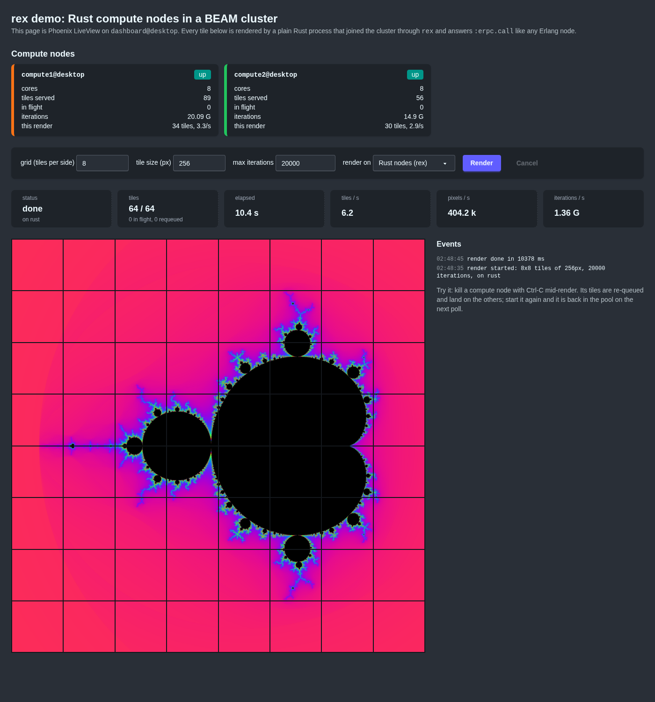

# rex

A native **Erlang distribution node in Rust**. `rex` registers with EPMD, speaks
the OTP 23+ distribution handshake and protocol, and joins a cluster of
Erlang/Elixir nodes as a peer — without running a BEAM and without NIFs.

Point `:erpc.call/4` at it and your Rust code answers:

```elixir
iex(app@desktop)> Node.connect(:"rex@desktop")
true
iex(app@desktop)> :erpc.call(:"rex@desktop", Rex.Math, :add, [1, 2])
3
iex(app@desktop)> Node.list(:hidden)
[:rex@desktop]
```

```rust
use rex::{Exception, FnModule, Node, Term};

#[tokio::main]
async fn main() -> rex::Result<()> {
    let node = Node::builder("rex@desktop")
        .cookie("secret")
        .module(FnModule::elixir("Rex.Math").function("add", 2, |args, _ctx| {
            let a = args[0].as_int().ok_or_else(Exception::badarg)?;
            let b = args[1].as_int().ok_or_else(Exception::badarg)?;
            Ok(Term::Int(a + b))
        }))
        .start()
        .await?;

    // Be found by libcluster's Gossip strategy, and find Elixir nodes using it.
    node.start_strategy(rex::cluster::Gossip::new());

    tokio::signal::ctrl_c().await.ok();
    node.shutdown();
    Ok(())
}
```

Tested against **Elixir 1.19 / OTP 28** and **libcluster 3.5**.

## What works

**Cluster membership**

- EPMD registration (`ALIVE2`), lookups (`PORT_PLEASE2`), auto-starting
  `epmd -daemon` when none is running, and an **embedded EPMD server** when
  there is no `epmd` binary at all, so a rex container needs no Erlang inside.
- Version-6 handshake (`N` frames) as both initiator and acceptor, including
  `alive` / `ok_simultaneous` / `nok` handling for simultaneous connects.
- Ticks every `net_ticktime / 4`, peers dropped after `net_ticktime` of silence.
- Distribution headers with the peer's **atom cache** (atoms arrive as one-byte
  references) and **fragmented messages** (`DIST_FRAG_HEADER`/`_CONT`,
  reassembled per sequence), so a multi-megabyte term from one Elixir process
  no longer holds up every other sender on the connection.
- Hidden node by default (like C/Java nodes; shows in `Node.list(:hidden)`).
  `.visible()` makes it a regular node in `Node.list()`.
- `Node.connect/1`, `Node.ping/1`, `Node.disconnect/1`, `:net_kernel.monitor_nodes`
  all behave normally from the Elixir side. `node.events()` gives you
  `NodeUp` / `NodeDown` on the Rust side.

**libcluster compatibility** (`rex::cluster`) — every core libcluster strategy
has a counterpart, verified against libcluster 3.5 and a real k3s cluster:

| libcluster                                       | rex                                                        |
|--------------------------------------------------|------------------------------------------------------------|
| `Cluster.Strategy.Gossip`                        | `Gossip` — same UDP multicast heartbeat, same AES-256-CBC `secret`, `broadcast_only`, `multicast_if`, TTL |
| `Cluster.Strategy.Epmd` (`hosts: [...]`)         | `Hosts` — static list, retried on an interval              |
| `Cluster.Strategy.LocalEpmd`                     | `LocalEpmd` — every node on the local EPMD                 |
| `Cluster.Strategy.ErlangHosts`                   | `ErlangHosts` — `.hosts.erlang` file + each host's EPMD    |
| `Cluster.Strategy.DNSPoll`                       | `DnsPoll` — A/AAAA records → `basename@ip`                 |
| `Cluster.Strategy.Kubernetes`                    | `Kubernetes` — the API, `endpoints` or `pods` by label selector, `ip`/`dns`/`hostname` naming, service-account token + CA |
| `Cluster.Strategy.Kubernetes.DNS`                | `KubernetesDns` — headless service A records → `app@<pod ip>` |
| `Cluster.Strategy.Kubernetes.DNSSRV`             | `KubernetesDnsSrv` — SRV records → `app@<pod>.<svc>.<ns>.svc.cluster.local` |
| `Cluster.Strategy.Rancher`                       | `Rancher` — metadata service → `basename@ip`               |
| `Cluster.Strategy.Nebula` (libcluster_nebula)    | `Nebula` — `lighthouse_dns`, `dns` and `static_host_map` backends, CIDR check, `ip`/`name` naming |
| anything else                                    | `Poll` — hand it an async fn that returns node names        |
| any strategy on the Elixir side                  | nothing needed: rex is registered with EPMD, so Elixir can always `Node.connect` to it |

The Kubernetes strategies disconnect from nodes that leave the topology, like
libcluster's do (`disconnect_missing`). DNS strategies share a `Resolver`
that is either the system one (search domains and `ndots` from
`/etc/resolv.conf`, which is what makes bare service names work inside a pod)
or a fixed set of nameservers, with optional DNS-over-TCP. Feature flags:
`dns` (hickory-resolver) and `http` (reqwest + rustls) are on by default and
can be disabled to drop those dependencies.

**Calling Rust from Erlang/Elixir** — register a `NativeModule` (or build one
from closures with `FnModule`) and reach it with:

- `:erpc.call/4,5`, `:erpc.cast/4`, `:erpc.multicall/4`, `:erpc.send_request/4`
  + `receive_response/2`
- `:rpc.call/4,5` (which uses erpc on OTP 23+), `:rpc.block_call/4`, `:rpc.cast/4`
- `Node.spawn/4`, `Node.spawn_link/4`, `:erlang.spawn_request/5` — with the
  requested links and monitors honoured, and exit reasons shaped like Erlang's
  (`{:badarith, [{Mod, :fun, args, []}]}`).
- Exceptions map one-to-one: `Err(Exception::Error(t))` is raised as an error on
  the caller, `Exit`/`Throw` likewise. Unknown functions give `:undef`.
- Each call runs as its own tokio task; `async_function` handlers may await
  (e.g. call back into the cluster with `ctx.node.rpc_call`). `ctx.puts` writes
  to the caller's shell through its group leader.
- Built-in modules: `rex` (`modules/0`, `functions/1`, `ping/0`, `node/0`,
  `version/0`) and a sliver of `erlang` (`node/0`, `nodes/0`, `whereis/1`,
  `registered/0`, `self/0`, `is_alive/0`, `system_info/1`).

**Calling Erlang/Elixir from Rust**

- `node.send(pid, term)` / `node.send_named(name, node, term)` — auto-connects.
- `node.call(dest, request, timeout)` — a `GenServer.call`, with monitor so a
  missing process gives `Error::NoProc` instead of a timeout. `node.cast`.
- `node.rpc_call(node, module, function, args, timeout)` — classic `rpc:call`
  via the remote `rex` server.
- `node.erpc_call(node, module, function, args, timeout)` — what `:erpc.call/5`
  does: a monitored `spawn_request` of `erpc:execute_call/4` on the peer, with
  the result read from the exit reason. Exceptions raised there come back as
  `Error::Exception(Exception::Error | Exit | Throw)`.
- `node.spawn_request(&mailbox, node, module, function, args, SpawnOpts { link, monitor })`
  — `erlang:spawn_request/5` towards a peer; the `{spawn_reply, ReqId, ok, Pid}`
  message and, with `monitor`, the `DOWN` land in the mailbox like in Erlang.
- `node.spawn_mailbox()` — a local process with a pid that remote nodes can
  send to, link to and monitor; `mailbox.register("name")` makes it reachable
  as `{:name, :"rex@host"}`. Drop it and linked/monitoring peers get
  `EXIT`/`DOWN` with reason `normal`.

**Terms** — `rex::Term` covers atoms, integers (bignums included), floats,
tuples, proper and improper lists, binaries, bitstrings, maps, pids, ports,
references, exports and funs (opaque). ETF encode/decode is in `rex::etf`.

## Running the demo

```sh
cargo run --example rex_node -- rex@$(hostname) --cookie rexcookie
# in another terminal
iex --sname app --cookie rexcookie
```

```elixir
Node.connect(:"rex@desktop")
:erpc.call(:"rex@desktop", :rex, :modules, [])           # => [Rex.Cluster, Rex.KV, Rex.Math, Rex.Strings, :erlang, :rex]
:erpc.call(:"rex@desktop", Rex.Strings, :word_count, ["a b a"])  # => %{"a" => 2, "b" => 1}
:erpc.call(:"rex@desktop", Rex.KV, :put, [:k, %{a: 1}])  # state lives in the Rust process
:erpc.call(:"rex@desktop", Rex.Cluster, :greet, ["you"]) # prints on *your* shell
send({:rex_inbox, :"rex@desktop"}, {self(), :hi}); flush() # => {:echo, :hi}
```

`elixir/test_rex.exs` drives the demo through ~40 checks (erpc/rpc in both
directions, casts, spawn/link/monitor, timeouts, errors, autoconnect):

```sh
elixir --sname app --cookie rexcookie elixir/test_rex.exs rex@desktop
```

`elixir/gossip_test.exs` starts libcluster's Gossip strategy and waits to be
paired with a gossiping rex (`--gossip [--gossip-secret S]`).

The demo node takes a flag per strategy (`--local-epmd`, `--erlang-hosts`,
`--dns-poll`, `--k8s`, `--k8s-dns`, `--k8s-dns-srv`, `--rancher`,
`--nebula-*`, `--poll-static`; see the top of `examples/rex_node.rs`). To try
the Kubernetes ones from a workstation:

```sh
kubectl proxy --port 8001 &                                  # API without a token
kubectl port-forward -n kube-system svc/kube-dns 5353:53 &   # cluster DNS over TCP
cargo run --example rex_node -- rex@$(hostname) \
  --k8s myapp app=myapp --k8s-ns default --k8s-api http://127.0.0.1:8001 --k8s-lookup pods
cargo run --example rex_node -- rex@$(hostname) \
  --k8s-dns-srv myapp-headless default myapp --nameserver 127.0.0.1:5353/tcp
```

`cargo test` runs the ETF/handshake unit tests plus `tests/elixir_interop.rs`,
which boots a real Elixir node and exercises both directions (skipped if
`elixir` is not on `PATH`).

## Demo: a LiveView dashboard driving Rust compute nodes

`demo/` is a two-part showcase: `demo/compute` is a Rust node that renders
Mandelbrot tiles and `demo/dashboard` a Phoenix LiveView page that discovers
the compute nodes, fans renders out over them with `:erpc.call`, shows
Rust-side progress live, and re-queues tiles when a node is killed
mid-render. See [demo/README.md](demo/README.md) for the walk-through.



## Benchmarks

`examples/bench_node.rs` (the Rust side), `elixir/bench_peer.exs` (the same
surface in Elixir, as the baseline) and `elixir/bench.exs` (the driver) measure
erpc calls, GenServer-style calls, raw message echoes and one-way floods in
both directions, at payload sizes from empty to 8 MiB:

```sh
cargo build --release --examples
elixir --sname base --cookie rexcookie elixir/bench_peer.exs &
./target/release/examples/bench_node rexbench@$(hostname) --cookie rexcookie --target base@$(hostname) &
elixir --sname driver --cookie rexcookie elixir/bench.exs rexbench@$(hostname) base@$(hostname)
```

`cargo run --release --example etf_bench` times the term layer alone (encode,
decode, clone) on the same payloads.

Elixir 1.19.6 / OTP 28 driving the node on one desktop (Linux, all three
nodes on the same host), calls per second from the driver's point of view.
"before" is the pass-through-only rex, "after" the current one, and the
baseline is the same driver calling the Elixir peer. Numbers move by 10–20 %
between runs on a shared machine; the ratios are what matter.

| Elixir -> rex, erpc echo           | before | after | Elixir -> Elixir |
|------------------------------------|-------:|------:|-----------------:|
| 0 B, 1 caller                      | 15 616 | 15 243 | 12 701 |
| 64 KiB, 1 caller                   | 10 443 |  8 822 |  7 165 |
| 1 MiB, 1 caller                    |    415 |  1 069 |    679 |
| 8 MiB, 1 caller                    |     51 |    116 |     61 |
| 1 KiB, 32 callers                  | 37 242 | 42 679 | 27 271 |
| 10k tuples+maps (447 KB)           |     54 |     81 |    151 |
| sum of 100k ints (499 KB, decode)  |    166 |    201 |    219 |
| raw message echo, 8 MiB            |     55 |    107 |     98 |
| one-way flood, 1 MiB               |  1 601 |  1 879 |  1 479 |

What changed between "before" and "after": the two full-term copies on
every inbound message are gone (the control-message parser cloned the
payload, and a process exit cloned its reason once per monitor), output
buffers are sized exactly from `etf::encoded_len` instead of growing by
doubling, atoms are reference counted, and the BEAM now sends us fragmented
messages and atom-cache references. Large binaries are at or above
BEAM-to-BEAM speed; deeply structured terms (the 10k tuples+maps row) are
still about half as fast, which is the per-element allocation of the `Term`
tree (`cargo run --release --example etf_bench` shows decode at ~4.5 ms and
encode at ~1 ms for that payload).

## Running in Kubernetes

Inside a pod everything defaults the way libcluster's does: the service
account token, CA and namespace are read from
`/var/run/secrets/kubernetes.io/serviceaccount`, the API is
`kubernetes.default.svc`, and `CLUSTER_DOMAIN` is honoured.

```rust
use rex::cluster::{IpLookupMode, Kubernetes, KubernetesDns, NodeNameMode};

// Deployment + headless service, Elixir peers started as app@$(POD_IP):
node.start_strategy(KubernetesDns::new("myapp-headless", "myapp"));
// or through the API, with a label selector:
node.start_strategy(Kubernetes::new("myapp", "app=myapp").ip_lookup_mode(IpLookupMode::Pods));
// StatefulSet peers named app@$(hostname -f):
node.start_strategy(Kubernetes::new("myapp", "app=myapp")
    .ip_lookup_mode(IpLookupMode::Pods).mode(NodeNameMode::Hostname).service_name("myapp-headless"));
```

Name the rex node the same way its peers are named (`rex@$(POD_IP)` with the
IP modes, `rex@$(hostname -f)` with hostname mode), expose EPMD (4369) and the
distribution port (`NodeBuilder::listen_port`) in the pod, and the Elixir
nodes' own libcluster strategy will find rex just as rex finds them. The API
strategy needs a Role allowing `list` on `pods` or `endpoints`, exactly as
libcluster does.

### Verified in k3s

`k8s/rex-demo.yaml` is the deployment used to prove this end to end on a real
k3s cluster: a `rex` Deployment (image from the `Dockerfile`, 145 MB, no Erlang
inside) and two Elixir pods (`elixir:1.19.6-otp-28`) running libcluster's
`Kubernetes.DNS` strategy over a shared headless service, all named
`app@<pod ip>`. rex runs `KubernetesDns` and the `Kubernetes` API strategy
(with the Role in the manifest). The Elixir pods log, every 10 seconds:

```text
[app@10.42.0.211] visible=[:"app@10.42.2.49"] hidden=[:"app@10.42.2.47"]
[app@10.42.0.211] rex=app@10.42.2.47 add=42 word_count=%{"in" => 1, "k3s" => 1, "rex" => 2, "works" => 1}
    modules=[Rex.Cluster, Rex.KV, Rex.Math, Rex.Strings, :erlang, :rex] rex_sees=[:"app@10.42.0.211", :"app@10.42.2.49"]
```

and rex logs `serving embedded EPMD`, then `connected via cluster strategy`
for each Elixir pod as libcluster and rex find each other from both sides.

```sh
docker build -t your.registry/rex:0.1.0 . && docker push your.registry/rex:0.1.0
# edit the image in k8s/rex-demo.yaml, then
kubectl apply -f k8s/rex-demo.yaml
kubectl -n rex-demo logs deploy/elixir -f
```

## Writing a native module

```rust
use rex::{CallContext, Exception, FnModule, Term};

let kv = FnModule::elixir("My.KV")                       // atom 'Elixir.My.KV'
    .function("get", 1, |args, _ctx| { /* sync */ Ok(Term::atom("nil")) })
    .async_function("fetch", 1, |args, ctx: CallContext| async move {
        // await anything; ctx.node lets you talk back to the cluster
        let who = ctx.node.rpc_call(ctx.peer.as_str(), "erlang", "node", vec![], std::time::Duration::from_secs(5))
            .await.map_err(|e| Exception::error(Term::string(e.to_string())))?;
        Ok(Term::tuple(vec![Term::atom("ok"), who]))
    })
    .variadic("echo", |args, _| Ok(Term::list(args)));
```

Implement the `NativeModule` trait directly when you want your own dispatch
(e.g. a generated binding table). Modules can be registered before start
(`NodeBuilder::module`) or at any time (`Node::register_module`).

## Naming

Match the peer's naming mode: `rex@shorthost` for `--sname` nodes,
`rex@fqdn` or `rex@10.0.0.5` for `--name` nodes. Erlang refuses to connect
short- and long-named nodes to each other.

## Not implemented (yet)

- `global` / `pg` participation: with `.visible()`, peers' `global` will send
  `init_connect` to a `global_name_server` that does not exist here. Clusters
  keep working, but `:global.sync/0` blocks until timeout. Hidden mode (the
  default) avoids this entirely.
- Sending with an atom cache or in fragments: we decode both, but our own
  frames carry an empty atom table and are never fragmented. Peers cope with
  that fine; it only means one large message from rex occupies the socket
  until it is written.
- Pre-OTP-23 (`n`) handshake, TLS distribution (`inet_tls_dist`), IPv6 EPMD.
- Running Erlang funs sent to us (`Node.spawn(rex, fn -> ... end)` exits with
  `undef`).
- Third-party libcluster strategies beyond Nebula (EC2 tags, Consul,
  Postgres...). `Poll` makes any of them a few lines of Rust.

## A note on multicast

If Gossip finds nothing even on one host, check the firewall: `ufw` on Arch /
Omarchy drops incoming multicast by default, so neither Elixir nor rex will
see any heartbeat (not even their own). `sudo ufw allow 45892/udp` fixes it, or
use `Hosts`/`DnsPoll`, or Gossip in `broadcast_only` mode.
